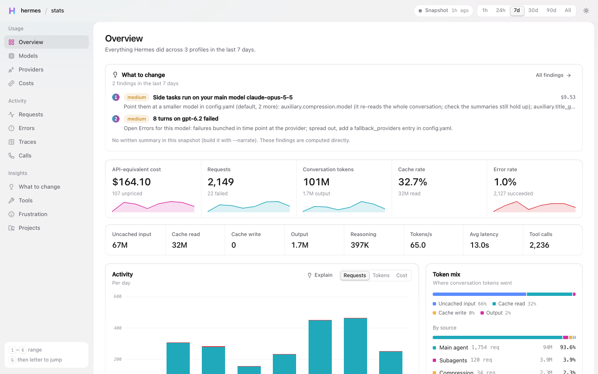
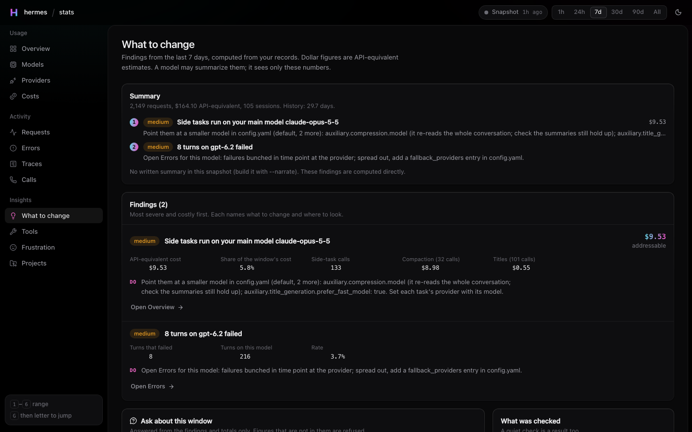
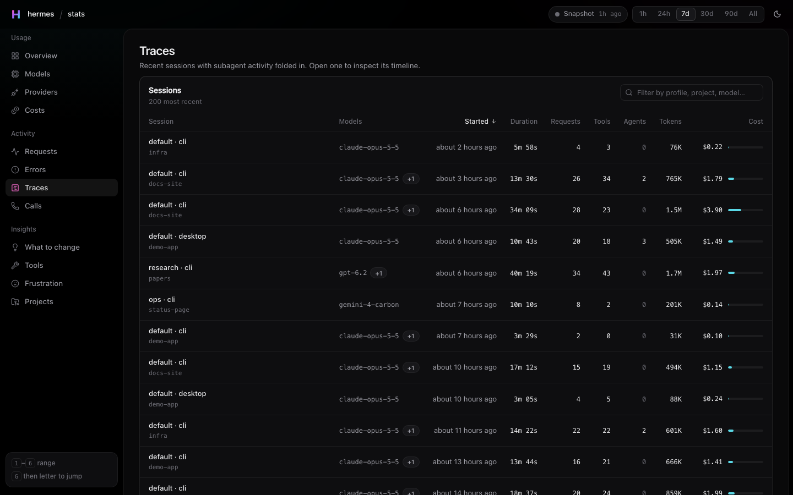
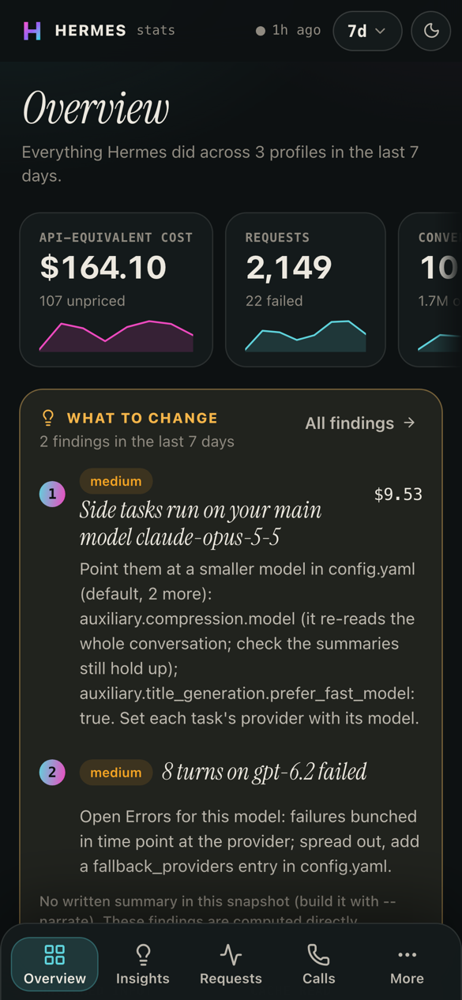

# Hermes Stats

A usage dashboard for [Hermes Agent](https://github.com/NousResearch/hermes-agent): what every profile did, on which models, at what API-equivalent cost, where turns failed, and what to change. It is the [Oh My Pi](https://github.com/can1357/oh-my-pi) `omp stats` dashboard with its data layer swapped for Hermes's session stores and, if you make z0live voice calls, their traces (`~/.local/share/z0live/voice-traces`, or `--voice-traces DIR`).



All screenshots come from a synthetic Hermes home (`scripts/demo_home.py`), not from anyone's real usage.

| What to change | Traces | Phone |
|---|---|---|
|  |  |  |

## Install

```bash
hermes plugins install kvnloo/hermes-stats
hermes stats serve            # then open http://127.0.0.1:8800/
```

The plugin also adds a **Stats** tab to `hermes dashboard` (after Analytics). The tab serves the same page and API from `/api/plugins/stats/`. After installing, run `curl http://127.0.0.1:9119/api/dashboard/plugins/rescan` or restart the dashboard. The tab loads the page in a frame, so it needs a dashboard that signs you in with a cookie, which is any dashboard behind a login. A loopback-only dashboard authenticates with a header that a frame can't send, so use `hermes stats serve` there.

It needs Hermes 0.22.0 or newer and nothing else at runtime. The plugin is standard-library Python, and the dashboard client ships prebuilt in `stats/dist`, so there is no Node, Bun or npm step.

## Use

```text
/stats                   what to change in the last 7 days, as text (also 24h, 30d, 90d, all)

hermes stats serve [--port 8800]              live dashboard on 127.0.0.1
hermes stats snapshot FILE [--narrate]        one self-contained HTML file, no server
hermes stats insights [--range 7d] [--json] [--narrate]
```

From a checkout, `bin/hermes-stats` takes the same subcommands and reads `$HERMES_HOME` (default `~/.hermes`).

### Pages

- Usage: Overview, Models, Providers and Costs, across every Hermes profile (`~/.hermes/state.db` and `~/.hermes/profiles/*/state.db`).
- Activity: Requests, Errors and Traces, plus Calls for z0live voice calls (turn gap, hand-off latency p50/p90, lane timings).
- Insights: What to change, Tools, Frustration (from z0live's per-turn `user.reaction` flags) and Projects.

Keys: `1` to `6` pick the range, `g` then a letter jumps to a page. On a phone the layout switches to a tab bar and sheets ([docs/MOBILE-DESIGN.md](docs/MOBILE-DESIGN.md)).

### What to change

The What to change page turns a window into findings. Each finding names a measured cause, its evidence, the Hermes setting to change, the API-equivalent cost it touches and the page that shows it. Five detectors run:

- Side tasks on the main model (compaction, approvals, background review, titles). The action names `auxiliary.<task>.provider` and `.model`.
- Subagents that inherit the main model. The action names `delegation.model` and `delegation.provider`.
- Big sessions with a measured cause: many subagents, repeated compactions, or a context much heavier than your typical session's.
- Failed turns per model and provider.
- z0live lanes in which one model rarely answers (voice users only).

Dollar figures are API-equivalent estimates. On a subscription they are not money you spent or will save. Requests with no price are left out of every dollar figure, and a note says how many there are.

### Summaries (optional)

A model can write a short summary with up to three actions, and answer questions on the live page. Nothing calls a model unless you ask: the **Write a summary** button, the **Ask** box, or `--narrate`. `/stats` and `hermes stats insights` show a summary only when one is already cached for the same data.

- Inside Hermes the model is your auxiliary model for the `stats_insights` task. Pick it in `hermes model` (Configure auxiliary models, listed as "Hermes Stats summaries") or set `auxiliary.stats_insights` in `config.yaml`. Unset, Hermes picks one.
- `--llm-url http://127.0.0.1:8080/v1` uses any OpenAI-compatible server instead, such as llama-server. `--llm-model` names the model and `--llm-key-env VAR` names an environment variable holding its key. From a checkout this is the only way to get a summary.
- Every number in a reply must match a number the model was given. If one does not, the reply is hidden and marked unverified, and the findings stand alone. Replies are cached by input in `~/.hermes/plugin-data/stats/insights-cache/`.

[docs/ADVISOR-INSIGHTS.md](docs/ADVISOR-INSIGHTS.md) records the review behind the detectors and guards.

## Privacy

- **Metadata only.** It reads ids, timestamps, model and provider names, token counts, costs, tool names, error kinds and the last folder name of each session's working directory. It never selects message content, titles, prompts, tool arguments, reasoning or transcripts. Every store opens read-only (`mode=ro`).
- **Local.** `serve` binds 127.0.0.1 and answers only to loopback `Host` headers. A cross-origin POST is refused, so another site cannot spend your tokens.
- **What a model sees.** A summary request sends the findings and totals only: counts, costs, timings, and model, provider and profile names. It never sends messages, prompts, titles, tool arguments, folder names or session ids. The page shows exactly what was sent.
- **Snapshots are yours to share or not.** A snapshot holds the same metadata as the live page, including profile, model and project folder names. It is written with owner-only permissions (0600). Read it before you publish it.
- **Writes:** only the summary cache above, and the snapshot file you name.
- **Network:** none, unless you ask for a summary. Then it goes to your Hermes auxiliary model or the `--llm-url` you pass. No telemetry.
- **Credentials:** none of its own. Inside Hermes the model call goes through `ctx.llm`, so Hermes holds the keys.

What Hermes does not record stays unknown rather than zero. Hermes stores token usage and cost per session and model, not per request, so each assistant message gets an equal share and the totals still reconcile with the store. Request duration is the gap from the previous message, and there is no time to first token. Omp's Gain and Spotlight pages are dropped because Hermes has no data for them.

## Develop

```bash
python3 -m unittest discover -s tests       # stdlib only; the install test needs `hermes` on PATH
cd stats && bun install && bun run check && bun run build.ts
python3 scripts/demo_home.py /tmp/demo      # synthetic data for screenshots
HERMES_HOME=/tmp/demo/home bin/hermes-stats snapshot /tmp/demo.html --voice-traces /tmp/demo/voice-traces
node stats/audit/audit.mjs --html /tmp/demo.html --out /tmp/audit   # phone layout audit
```

`tests/test_plugin.py` installs the plugin into a temporary `HERMES_HOME` with `hermes plugins install`, next to a neighbor plugin that registers its own slash command, CLI command, tool and hook (a stand-in, or a real checkout through `NEIGHBOR_PLUGIN_REPO` and `NEIGHBOR_PLUGIN_REF`), and loads both with Hermes's plugin loader. Commit `stats/dist` after rebuilding it, since installs use it as is.

## Credits and license

The dashboard client is forked from [Oh My Pi](https://github.com/can1357/oh-my-pi)'s `packages/stats` by Can Bölük and Stencil Labs, under the MIT license in `stats/LICENSE`. See [NOTICE](NOTICE) for every component and license.

Hermes Stats is licensed under the GNU General Public License v3.0 only, see [LICENSE](LICENSE).
